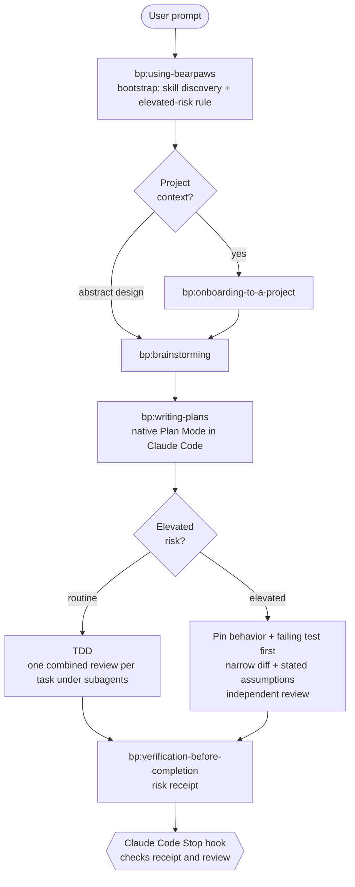

# Bearpaws

**Adaptive engineering discipline for coding agents.**

Bearpaws separates difficulty from danger. Elevated-risk work gets more proof: pinned behavior, a failing test first, an independent review, and verification evidence. Routine work stays light, however large it is. In Claude Code, the risk floor is enforced by a hook, not just requested.

## Difficulty is not danger

A one-line change to authentication logic is simple to write but carries high risk. A 500-line UI refactor is complex but carries low risk. Bearpaws treats complexity and risk as separate axes:

|  | **Low risk** | **High risk** |
|---|---|---|
| **Low complexity** | Implement with TDD where it applies, verify with fresh evidence | Pin existing behavior, failing test first, narrow diff, stated assumptions, independent review, verification evidence |
| **High complexity** | Written plan, a fresh subagent per task, one combined review per task | Written plan, a fresh subagent per task, spec review then quality review, a final review |

The deciding factor is **blast radius, not code size**:

| Change | Complexity | Risk | Treatment |
|---|---|---|---|
| Rename button text | Low | Low | Routine |
| Rewrite animation system | High | Low | Routine, planned |
| Change password-reset validation | Low | High | Elevated: authentication |
| Modify tenant authorization | Medium | Very high | Elevated: authorization |
| Add a database migration | Medium | High | Elevated: data migration |
| Change payment rounding | Low | High | Elevated: money |

Risk has two levels: routine and elevated. Bearpaws does not grade it any finer. When the classification is arguable, the change is elevated.

## Show me

Every reply that changed files ends with a risk receipt. Routine work needs only `Risk:`, `Verified:`, and `Status:`. Elevated work adds the rest:

```text
Risk: elevated (authorization)
Pinned: test_owner_allowed, test_admin_same_org passed before edit
Failing first: test_admin_cross_org_denied failed, then passed
Review: bp:code-reviewer — Ready to merge: Yes
Assumptions: org_id is never null on users or resources
Verified: pytest — 14 passed, 0 failed
Status: COMPLETE
```

In Claude Code, a `Stop` hook enforces the floor:

- A reply that leaves file edits pending without a receipt is blocked.
- Elevated work cannot end `Status: COMPLETE` unless a review was dispatched after the last edit. `Status: INCOMPLETE` is always allowed.
- Routine work that edited sensitive-looking paths (auth, token, payment, migration, sql, …) gets a one-time nudge to reclassify or say why it is routine.

Set `BEARPAWS_ENFORCE=0` to turn it off. It needs `jq` and Claude Code 2.1.163 or later; without either it does nothing. Elsewhere, these rules are instructions only. The hook checks that a receipt and a review exist, not that every line in the receipt is true.

## Evidence

The [escaped-defect benchmark](docs/benchmarks/2026-10-12-escaped-defects.md) was pre-registered: six elevated-risk tasks with hidden attack tests, 5 runs per task per arm, Sonnet in Claude Code.

- **Escaped defects:** Bearpaws 9/30, no plugin 12/30, Superpowers 6.4.2 12/30. The difference is **not statistically significant** (Fisher exact p = 0.59). Counting one run that ended INCOMPLETE with the defect still present, Bearpaws' figure is 10/30.
- Bearpaws eliminated the negative-refund defect (0/5 against 5/5 in each other arm). That comparison is post hoc and uncorrected, and rests on one attack. It was no better on reset tokens and slightly worse, within noise, on SQL sort injection and tenant authorization.
- In 7 of 9 Bearpaws escapes, its own reviewer flagged the defect and the agent still shipped `Status: COMPLETE`. That motivated the review-findings rule: a same-risk defect the review finds in the code you changed is part of the fix.
- **After that rule** (a same-arm before/after on the same frozen scenarios, not pre-registered): Bearpaws escapes fell from 9/30 to 3/30 (p = 0.10). SQL sort and tenant authorization went to 0, mostly through broader first fixes rather than fixes after review. All 3 remaining escapes are the reset-token single-use attack, which the agents' reviewers flagged and the agents left as outside the request. Cost rose about 33% per task. [Results](docs/bearpaws/plans/2026-10-12-review-findings.md#results-2026-10-12).
- **Cost:** on these risky tasks, Bearpaws cost about 2.4× Superpowers per task (and 4.7× no plugin); that includes a review on every run. On routine tasks it is about level with Superpowers: $0.098 against $0.096 per task in the [2026-09-30 run](docs/benchmarks/2026-09-30-three-way.md).

Small samples, Python stdlib scenarios, one model. Read the write-ups' limits before quoting these numbers.

## Install

**Claude Code:**

```bash
claude plugin marketplace add brandonfla/bearpaws
claude plugin install bp@bearpaws
```

For a local checkout, run `claude --plugin-dir /path/to/bearpaws`. For non-trivial work we recommend `/model opusplan`: Opus plans in native Plan Mode and Sonnet executes, and Bearpaws never switches models itself.

**Google Antigravity IDE:** clone, install, then restart Antigravity.

```bash
git clone https://github.com/brandonfla/bearpaws.git && cd bearpaws
./install.sh --antigravity --global
```

Codex, OpenCode, Grok Build, Copilot CLI, Cursor, Devin (experimental): see [docs/install.md](docs/install.md).

## How it works



A fully specified small fix goes straight to TDD and verification; plans are for non-trivial work. The bootstrap is small (about 4.9 KB, 4,876 bytes) and is the only thing loaded every session; every other skill loads on demand.

## Skills

| Skill | Type | Purpose |
|---|---|---|
| `bp:using-bearpaws` | Bootstrap | Skill discovery, the elevated-risk rule, and the risk receipt. Loaded at session start, never invoked directly. |
| `bp:onboarding-to-a-project` | Always first | Read the stack, project guidance, sample files, and test command before touching the codebase |
| `bp:brainstorming` | Process | Agree a design before creative work |
| `bp:writing-plans` | Process | Write implementation plans from specs |
| `bp:executing-plans` | Process | Execute a written plan with checkpoints |
| `bp:subagent-driven-development` | Process | A fresh subagent per task, with risk-proportional review |
| `bp:dispatching-parallel-agents` | Process | Run independent tasks in parallel subagents |
| `bp:test-driven-development` | Process | RED → GREEN → REFACTOR |
| `bp:systematic-debugging` | Process | Find the root cause before fixing |
| `bp:requesting-code-review` | Process | Dispatch an independent reviewer |
| `bp:receiving-code-review` | Process | Evaluate review feedback before applying it |
| `bp:verification-before-completion` | Process | Fresh evidence and the risk receipt before any completion claim |
| `bp:finishing-a-development-branch` | Process | Merge, PR, keep, or discard finished work |
| `bp:using-git-worktrees` | Process | Isolate feature work in git worktrees |
| `bp:writing-skills` | Process | Write and test skills with RED/GREEN evals |

## Bearpaws vs Superpowers

| | Superpowers 6.4.2 | Bearpaws |
|---|---|---|
| Workflow scaling | The same rigorous workflow for every task | Scaled by complexity × risk |
| Elevated-risk floor | No separate risk tier | Pinned behavior, failing test first, narrow diff, assumptions, independent review |
| Enforcement | Instructions | Instructions, plus a Claude Code `Stop` hook |
| Escaped defects (risk benchmark) | 12/30 | 9/30 (not significant, p = 0.59) |
| Cost on risky work (risk benchmark) | $0.092 per task | $0.219 per task, about 2.4× |
| Cost on routine work (2026-09-30 run) | $0.096 per task | $0.098 per task |

Bearpaws began as a fork of [Superpowers](https://github.com/obra/superpowers), and its engineering discipline comes from there.

## Support status

| Agent | Status | Evidence |
|---|---|---|
| Claude Code | Primary | Working |
| Google Antigravity IDE | Primary | Native plugin, skills, subagents, and capability adapter |
| OpenCode | Experimental | Wiring checked in CI: repo-level and global `.agents/skills` discovery, `instructions` bootstrap resolves; live bootstrap smoke-tested |
| Grok Build | Experimental | `./install.sh --grok --global`; `grok inspect` lists the bootstrap rule and all skills (1.0.45, built from source); no live session run |
| Other Agent Skills agents (Codex, Devin, Cursor, Copilot, …) | Experimental | Codex skills and `AGENTS.md` bootstrap checked in CI, activation smoke-tested; Copilot CLI installs the plugin (CI); Devin and Cursor hook payloads follow their docs, unverified live. Expanded conformance requires completed-action evidence. |

See [docs/agent-support.md](docs/agent-support.md) for the support policy and the evidence behind each status.

## More

- [Release notes](docs/bearpaws/release-notes/)
- Benchmarks: [escaped defects](docs/benchmarks/2026-10-12-escaped-defects.md), [three-way cost](docs/benchmarks/2026-09-30-three-way.md)
- [Skill structure](docs/skill-structure.md) and [testing](docs/testing.md)
- [CLAUDE.md](CLAUDE.md) for contributors: repo layout, the full test list, and how skills are edited

## Attribution

Bearpaws originated as a fork of **[superpowers](https://github.com/obra/superpowers)** v5.0.7 by Jesse Vincent and contributors, released under the MIT license. The MIT terms and upstream copyright are preserved in [LICENSE](LICENSE); Bearpaws now develops on its own line and is not affiliated with or endorsed by the superpowers project.

## License

MIT — see [LICENSE](LICENSE).
